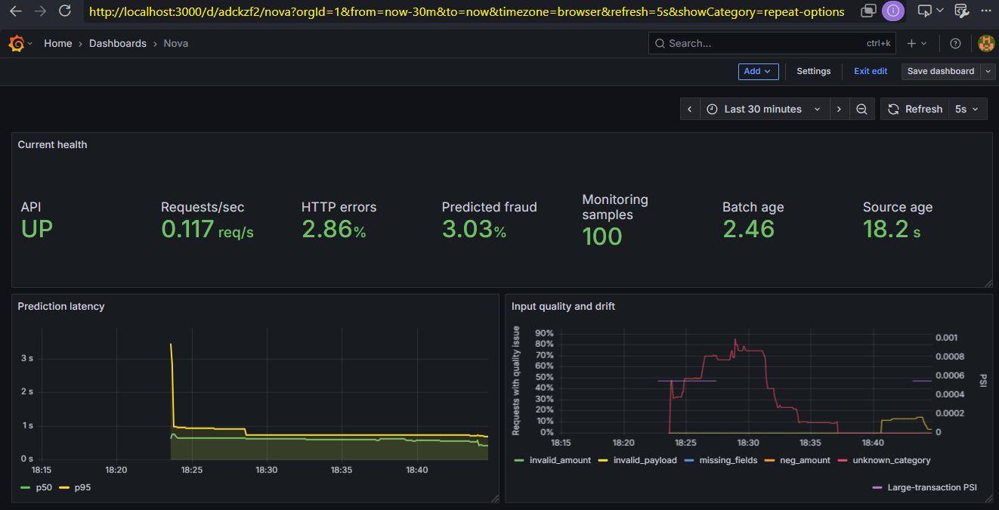
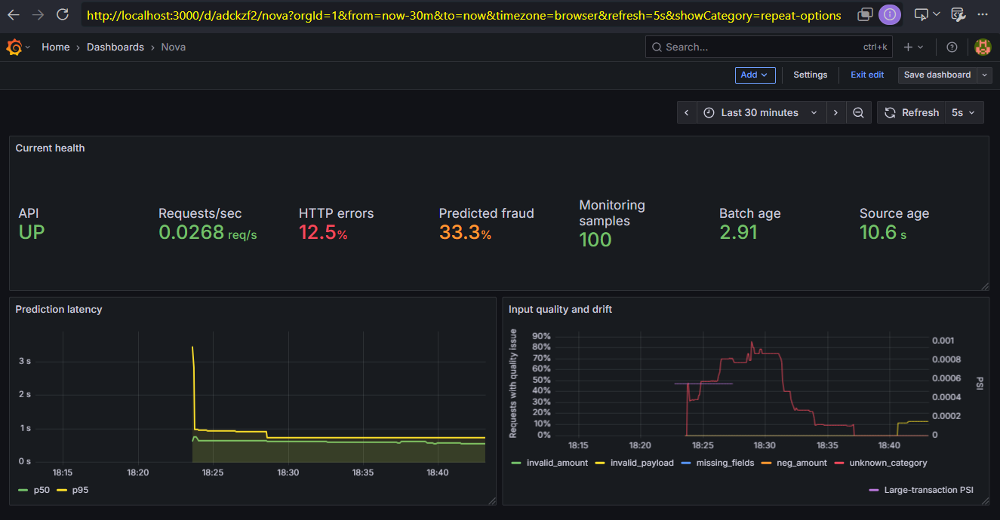
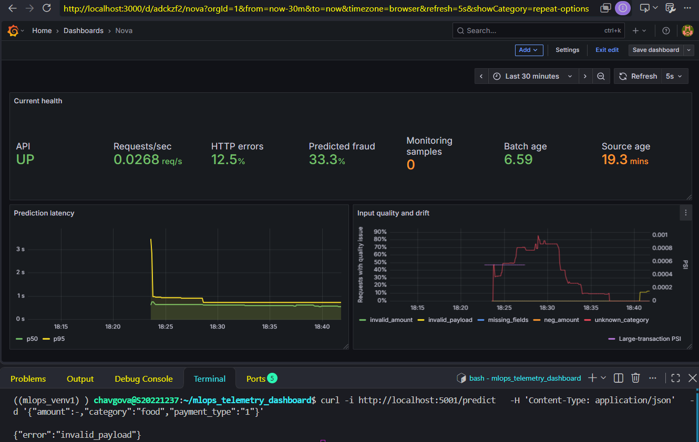

To start project:
docker compose --file infra/docker-compose.yaml up -d app grafana

The monitored metric families are `up`, `nova_http_request_total`,
`nova_http_request_duration_seconds`, `nova_predictions_total`,
`nova_data_quality_total`, `nova_monitoring_samples`, `nova_psi_s`,
`nova_monitoring_last_success_timestamp_seconds`, and
`nova_live_data_timestamp_seconds`.

Grafana Dashboard: 

