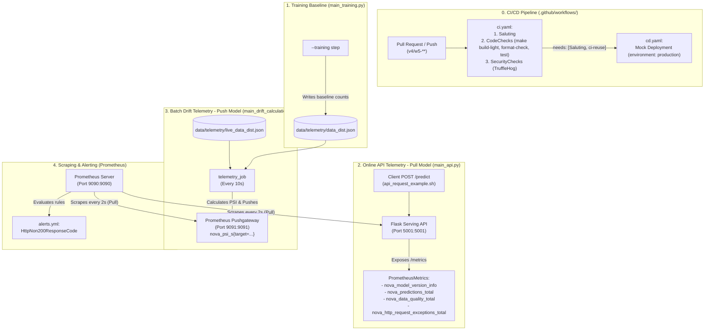

# Course Walk-Through: Telemetry, Monitoring & CI/CD (Week 5)

---

## Pedagogical Overview & Flow Map

This walk-through builds directly on **Week 4 (Container Orchestration & Model Serving)** and covers **Week 5**:
1. **Part I — Production Telemetry, Data Quality Monitoring, Drift Detection (PSI), and Alerting**
2. **Part II — Continuous Integration & Continuous Deployment (CI/CD) with GitHub Actions**

> [!NOTE]
> Sections covered in Week 4 (`v4/w4-deployment`) — such as the multi-step training CLI split, Airflow `DockerOperator` orchestration, Spark serialization in `FeatureExtractor`, MLflow artifact inspection, and cold-start `@cache` warming — are intentionally omitted here to avoid duplication.



### Flow at a Glance
- **Part I: Telemetry, Monitoring & Drift Detection**
  1. **Section 1: Telemetry Infrastructure & Pull vs. Push Architecture** — Inspect the telemetry services (`prometheus`, `prometheus_push_gateway`, `telemetry_job`, `training`) in [docker-compose.yaml](file:///Users/kemalty/uva-mlprod-code/infra/docker-compose.yaml) and scrape targets in [prometheus.yml](file:///Users/kemalty/uva-mlprod-code/infra/telemetry/prometheus.yml).
  2. **Section 2: Online API Telemetry & Data Quality Rules** — Inspect [main_api.py](file:///Users/kemalty/uva-mlprod-code/src/main_api.py) and [feature_extractor.py](file:///Users/kemalty/uva-mlprod-code/src/feature_extractor.py) to see how model metadata, prediction counters, and data quality violations are instrumented.
  3. **Section 3: Baseline Export & Batch Drift Detection (PSI)** — Trace how training distributions are saved in [main_training.py](file:///Users/kemalty/uva-mlprod-code/src/main_training.py), configured in [configs.py](file:///Users/kemalty/uva-mlprod-code/configs/configs.py), and compared against a sliding window of live data in [main_drift_calculation.py](file:///Users/kemalty/uva-mlprod-code/src/main_drift_calculation.py).
  4. **Section 4: Alerting Rules (`alerts.yml`)** — Inspect [alerts.yml](file:///Users/kemalty/uva-mlprod-code/infra/telemetry/alerts.yml) to understand how PromQL rate expressions detect non-200 HTTP failures.
  5. **Section 5: Live Execution #1 — Launching the Telemetry Stack** — Build and start the full stack with `make up` and verify targets in Prometheus and Pushgateway UIs.
  6. **Section 6: Live Execution #2 — Triggering Data Quality Metrics & Alerts** — Execute [api_request_example.sh](file:///Users/kemalty/uva-mlprod-code/scripts/api_request_example.sh) to observe normal predictions, negative-amount warnings, and unknown-category HTTP 500 alerts firing in Prometheus.
  7. **Section 7: Live Execution #3 — Observing & Simulating PSI Drift** — Query `nova_psi_s` in Prometheus and inspect how live distribution shifts affect PSI.
- **Part II: CI/CD with GitHub Actions**
  8. **Section 8: Continuous Integration (`ci.yaml`, `Dockerfile.light`, `Makefile`)** — Walk through all `# note:` annotations in [ci.yaml](file:///Users/kemalty/uva-mlprod-code/.github/workflows/ci.yaml), lightweight container builds in [Dockerfile.light](file:///Users/kemalty/uva-mlprod-code/infra/build/Dockerfile.light), `Makefile` command reuse, containerized linting/testing, and TruffleHog secret scanning.
  9. **Section 9: Continuous Deployment & Workflow Reuse (`cd.yaml`)** — Walk through [cd.yaml](file:///Users/kemalty/uva-mlprod-code/.github/workflows/cd.yaml), `workflow_call` reuse (`ci-reuse`), job gating (`needs`), and deployment environments.
  10. **Section 10: Live Execution #4 — Running CI Checks Locally & Inspecting GitHub Actions** — Run `make build-light`, `docker run nova make format-check`, and `docker run nova make test` live, and inspect PR/workflow runs on GitHub.
  11. **Section 11: Instructor Wrap-Up & Discussion Guide** — Compare classroom telemetry and CI/CD setups with enterprise production architectures.

---

# Part I: Telemetry, Monitoring & Drift Detection

## Section 1: Telemetry Infrastructure & Pull vs. Push Architecture

### 🎯 Learning Objective
Understand why an ML system requires both **pull-based** scraping (for long-lived online inference services) and **push-based** metrics collection (for ephemeral/batch drift calculation jobs), and how they are wired together in Docker Compose and Prometheus.

### 🔍 Code Walkthrough & Notes

Open [infra/docker-compose.yaml](file:///Users/kemalty/uva-mlprod-code/infra/docker-compose.yaml) and [infra/telemetry/prometheus.yml](file:///Users/kemalty/uva-mlprod-code/infra/telemetry/prometheus.yml):

#### 1. Automated Startup Dependencies (`training`, `app`, & MLflow Host Check)
- **Code:** [docker-compose.yaml#L3-L33](file:///Users/kemalty/uva-mlprod-code/infra/docker-compose.yaml#L3-L33)
  ```yaml
  training:
    image: nova:latest
    command: python src/main_training.py --preprocess --feat-eng --training
    depends_on:
      mlflow:
        condition: service_healthy

  app:
    ...
    depends_on:
      mlflow:
        condition: service_healthy
      prometheus:
        condition: service_healthy
      telemetry_job:
        condition: service_started
      training:
        condition: service_completed_successfully

  mlflow:
    image: ghcr.io/mlflow/mlflow:v3.17.0
    # See also: https://github.com/mlflow/mlflow/issues/16659
    command: mlflow server --host 0.0.0.0 --port 8080 --allowed-hosts *
  ```
- **Instructor Note:**
  - Unlike Week 4 where we triggered training manually via Airflow before starting `app`, here `docker-compose.yaml` includes a one-shot `training` container (`service_completed_successfully`) so that a single `make up` command populates MLflow and generates the baseline training distribution before `app` boots.
  - Point out [docker-compose.yaml#L30-L32](file:///Users/kemalty/uva-mlprod-code/infra/docker-compose.yaml#L30-L32): upgrading MLflow to `v3.17.0` requires `--allowed-hosts *` because newer MLflow versions enforce DNS rebinding protection and reject requests sent to internal Docker service hostnames like `http://mlflow:8080` by default (see [mlflow#16659](https://github.com/mlflow/mlflow/issues/16659)).
  - Also note [Dockerfile#L16](file:///Users/kemalty/uva-mlprod-code/infra/build/Dockerfile#L16), which adds `COPY data/telemetry/ data/telemetry/` into the image.

#### 2. Prometheus, Pushgateway & the Telemetry Job
- **Code:** [docker-compose.yaml#L40-L67](file:///Users/kemalty/uva-mlprod-code/infra/docker-compose.yaml#L40-L67)
  ```yaml
  prometheus:
    image: prom/prometheus:v3.5.0
    depends_on:
      - prometheus_push_gateway
    volumes:
      - "./telemetry/prometheus.yml:/etc/prometheus/prometheus.yml"
      - "./telemetry/alerts.yml:/etc/prometheus/alerts.yml"
    ports:
      - "9090:9090"

  prometheus_push_gateway:
    image: prom/pushgateway:v1.11.1
    ports:
      - "9091:9091"

  telemetry_job:
    image: nova:latest
    command: ["/bin/sh", "-c", "while true; do sleep 10; python src/main_drift_calculation.py ; done"]
    depends_on:
      - prometheus
  ```
- **Instructor Note:**
  - **Why Pushgateway?** Prometheus uses a **pull model**—it scrapes HTTP endpoints on a schedule. However, `src/main_drift_calculation.py` is a short-lived batch script, not a persistent web server. It calculates drift, pushes the result to `prometheus_push_gateway` on port `9091`, and exits.
  - Here, `telemetry_job` simulates a scheduled cron/batch job by running `python src/main_drift_calculation.py` every 10 seconds.

#### 3. Prometheus Scrape Configuration (`prometheus.yml`)
- **Code:** [prometheus.yml#L1-L18](file:///Users/kemalty/uva-mlprod-code/infra/telemetry/prometheus.yml#L1-L18)
  ```yaml
  global:
    scrape_interval: 2s
  scrape_configs:
   - job_name: prometheus
     ...
   - job_name: nova
     static_configs:
       - targets:
         - app:5001
   - job_name: prometheus_push_gateway
     honor_labels: true
     static_configs:
       - targets:
         - prometheus_push_gateway:9091
  rule_files:
    - "/etc/prometheus/alerts.yml"
  ```
- **Instructor Note:**
  - `scrape_interval: 2s` is set aggressively for fast classroom feedback.
  - `job_name: nova` scrapes our Flask API (`app:5001/metrics`).
  - `job_name: prometheus_push_gateway` scrapes `prometheus_push_gateway:9091`. Point out `honor_labels: true` ([prometheus.yml#L13](file:///Users/kemalty/uva-mlprod-code/infra/telemetry/prometheus.yml#L13)): this ensures Prometheus preserves the `job="telemetryBatch"` label attached by the batch script rather than overwriting it with `job="prometheus_push_gateway"`.

---

## Section 2: Online API Telemetry & Data Quality Rules

### 🎯 Learning Objective
Instrument an online model-serving API to expose operational metrics, model lineage metadata, prediction class distributions, and real-time input data quality checks.

### 🔍 Code Walkthrough & Notes

Open [src/main_api.py](file:///Users/kemalty/uva-mlprod-code/src/main_api.py) and [src/feature_extractor.py](file:///Users/kemalty/uva-mlprod-code/src/feature_extractor.py):

#### 1. Exporter Initialization & Model Version Metadata
- **Code:** [main_api.py#L47-L60](file:///Users/kemalty/uva-mlprod-code/src/main_api.py#L47-L60)
  ```python
  metrics = PrometheusMetrics(app, defaults_prefix=run_config.app_name)
  metrics.info(
      f"{run_config.app_name}_model_version",
      "Model version information",
      experiment_name=run_config.experiment_name,
      run_name=run_config.run_name,
      model_name=ModelConfig.model_name,
  )

  pred_counter = Counter(f"{run_config.app_name}_predictions", "Count of predictions by class", labelnames=["pred"])
  data_quality_counter = Counter(
      f"{run_config.app_name}_data_quality", "Count of data quality issues", labelnames=["quality_rule"]
  )
  ```
- **Instructor Note:**
  - `PrometheusMetrics(app, defaults_prefix="nova")` automatically exposes `/metrics` and tracks HTTP request latency histograms, status codes, and unhandled exceptions (`nova_http_request_exceptions_total`).
  - `metrics.info(...)` exposes `nova_model_version_info` so dashboards can correlate latency or accuracy changes with the exact deployed `experiment_name`, `run_name`, and `model_name`.
  - `pred_counter` and `data_quality_counter` are custom Prometheus `Counter` objects (monotonically increasing counters).

#### 2. Excluding `/health` from Telemetry
- **Code:** [main_api.py#L63-L67](file:///Users/kemalty/uva-mlprod-code/src/main_api.py#L63-L67)
  ```python
  @app.route("/health", methods=["GET"])
  @metrics.do_not_track()
  def health():
  ```
- **Instructor Note:** Docker pings `/health` every 30 seconds. Decorating it with `@metrics.do_not_track()` prevents synthetic health checks from artificially inflating request counts or skewing latency percentiles.

#### 3. Real-Time Data Quality Checks & Prediction Counting
- **Code:** [main_api.py#L77-L102](file:///Users/kemalty/uva-mlprod-code/src/main_api.py#L77-L102) and [feature_extractor.py#L152-L164](file:///Users/kemalty/uva-mlprod-code/src/feature_extractor.py#L152-L164)
  ```python
  if request.json["amount"] < 0:
      logging.warning("Received negative amount in request.")
      data_quality_counter.labels(quality_rule="neg_amount").inc()
  if category_received := request.json["category"] not in feature_extractor.get_known_categories():
      logging.error(f"Received unknown category in request: {category_received}.")
      data_quality_counter.labels(quality_rule="unknown_category").inc()
  ...
  prediction = model.predict(features)[0].item()
  pred_counter.labels(pred="true" if prediction else "false").inc()
  ```
- **Instructor Note:**
  - Recall our Week 4 discussion prompt: *"What happens if a request arrives with an unseen category?"*
  - First, [FeatureExtractor.get_known_categories()](file:///Users/kemalty/uva-mlprod-code/src/feature_extractor.py#L152-L164) extracts the known categories from the fitted `_mean_amount_per_category` and `_std_amount_per_category` dictionaries.
  - Notice the difference between the two data quality rules in `/predict`:
    1. **Soft Violation (`neg_amount`)**: A negative transaction amount increments `nova_data_quality_total{quality_rule="neg_amount"}` and logs a warning, but inference still succeeds (`200 OK`).
    2. **Hard Violation (`unknown_category`)**: An unknown category increments `nova_data_quality_total{quality_rule="unknown_category"}`, logs an error, and then crashes inside [`_get_z_score_per_category()`](file:///Users/kemalty/uva-mlprod-code/src/feature_extractor.py#L245-L249) with a `ValueError`! This results in an HTTP `500` response and increments `nova_http_request_exceptions_total`.

---

## Section 3: Baseline Export & Batch Drift Detection (PSI)

### 🎯 Learning Objective
Understand how **Population Stability Index (PSI)** quantifies distribution shift between training data and recent production traffic, and how sliding windows and epsilon smoothing are implemented.

### 🔍 Code Walkthrough & Notes

Open [src/main_training.py](file:///Users/kemalty/uva-mlprod-code/src/main_training.py), [configs/configs.py](file:///Users/kemalty/uva-mlprod-code/configs/configs.py), and [src/main_drift_calculation.py](file:///Users/kemalty/uva-mlprod-code/src/main_drift_calculation.py):

#### 1. Saving the Baseline Distribution During Training
- **Code:** [main_training.py#L63-L71](file:///Users/kemalty/uva-mlprod-code/src/main_training.py#L63-L71)
  ```python
  telemetry_data = {
      "is_large_transaction": {
          False: sum(not data["is_large_transaction"]),
          True: sum(data["is_large_transaction"]),
      },
      "is_fraud": {False: sum(not data["fraud"]), True: sum(data["fraud"])},
  }
  with open(PathsConfig.telemetry_training_data_path, "w") as file:
      json.dump(telemetry_data, file)
  ```
- **Instructor Note:** Drift detection requires a reference baseline. At the end of the `--training` stage, we record class counts for both an input feature (`is_large_transaction` — **covariate/feature drift**) and the target label (`is_fraud` — **prediction/concept drift**) to [data/telemetry/data_dist.json](file:///Users/kemalty/uva-mlprod-code/data/telemetry/data_dist.json) ([PathsConfig#L18](file:///Users/kemalty/uva-mlprod-code/configs/configs.py#L18)).

#### 2. Sliding Window & Telemetry Configuration
- **Code:** [configs.py#L42-L63](file:///Users/kemalty/uva-mlprod-code/configs/configs.py#L42-L63)
  ```python
  @dataclass(frozen=True)
  class TelemetryConfig:
      # ... (See docstring example in configs.py#L44-L60)
      num_instances_for_live_dist: int = 3
      epsilon: float = 1 / 1e100
      push_gateway_uri: str = "http://prometheus_push_gateway:9091"
  ```
- **Instructor Note:** Walk through the docstring table in [configs.py#L44-L60](file:///Users/kemalty/uva-mlprod-code/configs/configs.py#L44-L60). To form a "live" distribution representing recent behavior, we take the most recent `num_instances_for_live_dist` (`3` for demo purposes; thousands in production) predictions ordered by timestamp.

#### 3. PSI Calculation & Epsilon Smoothing
- **Code:** [main_drift_calculation.py#L18-L70](file:///Users/kemalty/uva-mlprod-code/src/main_drift_calculation.py#L18-L70)
  ```python
  def get_psi(training_percentages: typing.Tuple[float], latest_percentages: typing.Tuple[float]) -> float:
      psi = 0
      for training, latest in zip(training_percentages, latest_percentages):
          psi += (latest - training) * math.log(latest / training, math.e)
      return psi
  ```
- **Instructor Note:**
  - **Window Slicing & Guard Check** ([main_drift_calculation.py#L32-L40](file:///Users/kemalty/uva-mlprod-code/src/main_drift_calculation.py#L32-L40)): Sorts [data/telemetry/live_data_dist.json](file:///Users/kemalty/uva-mlprod-code/data/telemetry/live_data_dist.json) descending by `timestamp`, slices the top 3 rows, and exits cleanly if fewer than 3 live instances have been recorded. (Show [scripts/create_mock_telemetry_live_data.py](file:///Users/kemalty/uva-mlprod-code/scripts/create_mock_telemetry_live_data.py#L8-L23) to explain how the mock live dataset was created).
  - **Why `TelemetryConfig.epsilon`?** ([main_drift_calculation.py#L45-L56](file:///Users/kemalty/uva-mlprod-code/src/main_drift_calculation.py#L45-L56)): In small windows (like `N=3`), it is common for a rare class like `is_fraud=True` to have `0` occurrences. Without adding `epsilon` (`1e-100`), `math.log(latest / training)` would fail with `ValueError: math domain error` ($\ln(0)$) or `ZeroDivisionError`.
  - **Gauge vs. Counter** ([main_drift_calculation.py#L60-L70](file:///Users/kemalty/uva-mlprod-code/src/main_drift_calculation.py#L60-L70)): Because PSI can go both **up and down** over time, we use a Prometheus `Gauge` (`nova_psi_s` with label `target`) instead of a `Counter`, and push it to Pushgateway under `job="telemetryBatch"`.

---

## Section 4: Alerting Rules (`infra/telemetry/alerts.yml`)

### 🎯 Learning Objective
Understand how Prometheus evaluates PromQL alerting rules over sliding time windows and manages alert lifecycle states (`Inactive` $\rightarrow$ `Pending` $\rightarrow$ `Firing`).

### 🔍 Code Walkthrough & Notes

Open [infra/telemetry/alerts.yml](file:///Users/kemalty/uva-mlprod-code/infra/telemetry/alerts.yml#L1-L12):

```yaml
groups:
- name: HttpAlerts
  rules:
  - alert: HttpNon200ResponseCode
    expr: sum by (job, instance) (rate(nova_http_request_exceptions_total{code!~"200"}[1m])) > 0
    for: 1m
    labels:
      severity: error
    annotations:
      summary: "Non-200 HTTP codes for job '{{ $labels.job }}'"
      description: "Job '{{ $labels.job }}' on instance '{{ $labels.instance }}' is experiencing non-200 HTTP response codes. The current value is {{ $value }} requests per second."
      runbook_url: "https://your-runbook-url/http-errors"
```

- **Instructor Note:**
  - `rate(nova_http_request_exceptions_total{code!~"200"}[1m]) > 0`: Calculates the per-second rate of unhandled HTTP exceptions over the last 1 minute.
  - `for: 1m`: Prevents alert fatigue from isolated single-request blips; the condition must hold continuously for 1 minute before transitioning from **Pending** to **Firing**.
  - Point out `runbook_url` in `annotations`: in production on-call rotations (PagerDuty/Alertmanager), every actionable alert should link to a runbook explaining how to triage the issue.

---

## Section 5: Live Execution #1 — Launching the Telemetry Stack

### 🎯 Learning Objective
Build and launch the integrated training, serving, and monitoring stack and verify service discovery in Prometheus and Pushgateway.

### 💻 Live Commands

Run from the repository root (refer to [Makefile#L16-L29](file:///Users/kemalty/uva-mlprod-code/Makefile#L16-L29)):

```bash
make up
```

> [!TIP]
> Explain what `make up` executes under the hood:
> 1. `docker build . -t nova -f infra/build/Dockerfile`
> 2. `docker compose --file infra/docker-compose.yaml down`
> 3. `docker compose --file infra/docker-compose.yaml up app` — which automatically starts `mlflow`, runs `training` to completion, starts `prometheus_push_gateway`, `prometheus`, and `telemetry_job`, and finally starts `app`.

### 🗣️ Step-by-Step Browser Verification

1. **Prometheus Targets**: Open [`http://localhost:9090/targets`](http://localhost:9090/targets)
   - Verify that all three scrape jobs (`nova` at `http://app:5001/metrics`, `prometheus` at `http://prometheus:9090/metrics`, and `prometheus_push_gateway` at `http://prometheus_push_gateway:9091/metrics`) show state **`UP`**.
2. **Raw API Metrics Endpoint**: Open [`http://localhost:5001/metrics`](http://localhost:5001/metrics)
   - Show students the plain-text OpenMetrics format exposed by `PrometheusMetrics` in `src/main_api.py`.
3. **Pushgateway UI**: Open [`http://localhost:9091`](http://localhost:9091)
   - Expand the `job="telemetryBatch"` group and show `nova_psi_s{target="is_fraud"}` and `nova_psi_s{target="is_large_transaction"}` being updated every 10 seconds by `telemetry_job`.

---

## Section 6: Live Execution #2 — Triggering Data Quality Metrics & Alerts

### 🎯 Learning Objective
Observe how normal requests, soft data quality violations, and hard data quality exceptions propagate from the Flask API into Prometheus counters and alerts.

### 💻 Live Commands & Verification

Open [scripts/api_request_example.sh](file:///Users/kemalty/uva-mlprod-code/scripts/api_request_example.sh#L1-L18) and run each request in a second terminal tab:

#### 1. Normal Prediction Request
- **Code:** [api_request_example.sh#L1-L5](file:///Users/kemalty/uva-mlprod-code/scripts/api_request_example.sh#L1-L5)
  ```bash
  curl \
  -H "Content-Type: application/json" \
  -d '{"amount":123.00, "category":"food", "payment_type": "1"}' \
   -X POST http://127.0.0.1:5001/predict
  ```
- **Verify in Prometheus (`http://localhost:9090/query`)**:
  - Query `nova_model_version_info` $\rightarrow$ inspect labels `experiment_name="Alpha"`, `model_name="alpha"`, `run_name="Run_234"`.
  - Query `nova_predictions_total` $\rightarrow$ observe `pred="false"` incremented to `1`.

#### 2. Soft Data Quality Violation (Negative Amount)
- **Code:** [api_request_example.sh#L7-L11](file:///Users/kemalty/uva-mlprod-code/scripts/api_request_example.sh#L7-L11)
  ```bash
  curl \
  -H "Content-Type: application/json" \
  -d '{"amount":-222.00, "category":"food", "payment_type": "1"}' \
   -X POST http://127.0.0.1:5001/predict
  ```
- **Verify in Terminal & Prometheus**:
  - Observe the API still returns `false` (`200 OK`), and server logs print `WARNING:root:Received negative amount in request.`.
  - Query `nova_data_quality_total` in Prometheus $\rightarrow$ observe `{quality_rule="neg_amount"}` is now `1`.

#### 3. Hard Data Quality Violation (Unknown Category $\rightarrow$ HTTP 500 Alert)
- **Code:** [api_request_example.sh#L13-L17](file:///Users/kemalty/uva-mlprod-code/scripts/api_request_example.sh#L13-L17)
  ```bash
  curl \
  -H "Content-Type: application/json" \
  -d '{"amount":222.00, "category":"thiscatdoesntexist", "payment_type": "1"}' \
   -X POST http://127.0.0.1:5001/predict
  ```
- **Verify in Terminal & Prometheus**:
  - Observe the `500 Internal Server Error` and traceback in the `app` logs (`ValueError: z_score cannot be calculated as expected categories differ...`).
  - Query `nova_data_quality_total` $\rightarrow$ `{quality_rule="unknown_category"}` is now `1`.
  - Query `nova_http_request_exceptions_total` $\rightarrow$ increments on each failed call.
  - Open [`http://localhost:9090/alerts`](http://localhost:9090/alerts):
    - Show `HttpNon200ResponseCode` in **`Pending`** state.
    - Re-run the unknown category `curl` command once or twice over 60 seconds so the `1m` window stays above 0, then refresh `/alerts` to show it transitioning to **`Firing`**!

---

## Section 7: Live Execution #3 — Observing & Simulating PSI Drift

### 🎯 Learning Objective
Query drift metrics in Prometheus and trace how the PSI value is computed from the training baseline and live sliding window.

### 🗣️ Step-by-Step Instructor Guide

1. In Prometheus (`http://localhost:9090/query`), run:
   ```promql
   nova_psi_s
   ```
2. Switch to the **Graph** tab to show the time series for:
   - `nova_psi_s{job="telemetryBatch", target="is_fraud"}`
   - `nova_psi_s{job="telemetryBatch", target="is_large_transaction"}`
3. Open [data/telemetry/data_dist.json](file:///Users/kemalty/uva-mlprod-code/data/telemetry/data_dist.json) and [data/telemetry/live_data_dist.json](file:///Users/kemalty/uva-mlprod-code/data/telemetry/live_data_dist.json) side-by-side:
   - Point out that in `data_dist.json`, fraud is a tiny fraction of transactions (~1.2%), whereas in the latest 3 records of `live_data_dist.json` (generated by [scripts/create_mock_telemetry_live_data.py](file:///Users/kemalty/uva-mlprod-code/scripts/create_mock_telemetry_live_data.py#L9-L22)), 2 out of 3 predictions are `is_fraud: true` (66.7%).
   - Ask students: *"With PSI > 0.25 generally indicating significant distribution shift, what does the high PSI value on `is_fraud` tell us?"*

---

# Part II: Continuous Integration & Continuous Deployment (CI/CD)

## Section 8: Continuous Integration (`.github/workflows/ci.yaml`)

### 🎯 Learning Objective
Understand how GitHub Actions automates code quality, unit testing, and security checks on every Pull Request/Push using lightweight Docker builds and `Makefile` targets without duplicating local commands.

### 🔍 Code Walkthrough & Notes

Open [.github/workflows/ci.yaml](file:///Users/kemalty/uva-mlprod-code/.github/workflows/ci.yaml), [infra/build/Dockerfile.light](file:///Users/kemalty/uva-mlprod-code/infra/build/Dockerfile.light), and [Makefile](file:///Users/kemalty/uva-mlprod-code/Makefile):

#### 1. Course Context & Why GitHub Actions?
- **Code:** [ci.yaml#L1-L7](file:///Users/kemalty/uva-mlprod-code/.github/workflows/ci.yaml#L1-L7)
  ```yaml
  # note: This is the last week's material, CI/CD, is without any assignments. In the course project, it will also not be
  # note: expected to be included.
  # note: We will use GitHub (GH) Actions: the CI/CD solution for and from GitHub. As (1) we are hosting our repo on GitHub,
  # note: and (2) you will not have to use it in any of your work - so you won't have to pay for it - it is a good
  # note: choice to introduce CI/CD with GH Actions.
  #
  # note: Always good to read the documentation! https://docs.github.com/en/actions
  ```
- **Instructor Note:** Reassure students upfront: CI/CD is not part of the graded assignments or course project requirements, so they won't incur any GitHub Actions billing minutes. We use GitHub Actions because our repository is already hosted on GitHub, making it the most natural, zero-setup way to learn CI/CD. Point them to the official [GitHub Actions Documentation](https://docs.github.com/en/actions).

#### 2. Dynamic Workflow Run Names & Triggers (`on:`)
- **Code:** [ci.yaml#L9-L22](file:///Users/kemalty/uva-mlprod-code/.github/workflows/ci.yaml#L9-L22)
  ```yaml
  name: Nova CI Workflow
  run-name: ${{ github.workflow }}  - ${{ github.actor }}  # note: https://docs.github.com/en/actions/reference/workflows-and-actions/contexts#github-context
  on:
    workflow_call:

    pull_request:       # note: https://docs.github.com/en/actions/reference/workflows-and-actions/events-that-trigger-workflows#pull_request
      branches:
        - v4/w5-ci-cd
        - v4/w5-**      # note: https://github.com/kemalty/uva-mlprod-code/pull/1
    push:               # note: https://docs.github.com/en/actions/reference/workflows-and-actions/events-that-trigger-workflows#push
      branches:
        - v3/w7-ci-cd
        - v3/w7-**
  ```
- **Instructor Note:**
  - **GitHub Context (`${{ ... }}`)** ([ci.yaml#L10](file:///Users/kemalty/uva-mlprod-code/.github/workflows/ci.yaml#L10)): Demonstrates reading metadata from the [`github` context](https://docs.github.com/en/actions/reference/workflows-and-actions/contexts#github-context) so every workflow run displays the workflow name and the developer (`github.actor`) who triggered it.
  - **Event Triggers** ([ci.yaml#L11-L22](file:///Users/kemalty/uva-mlprod-code/.github/workflows/ci.yaml#L11-L22)):
    1. `workflow_call`: Allows another workflow (like `cd.yaml`) to call this entire CI workflow as a reusable subroutine.
    2. [`pull_request`](https://docs.github.com/en/actions/reference/workflows-and-actions/events-that-trigger-workflows#pull_request) & [`push`](https://docs.github.com/en/actions/reference/workflows-and-actions/events-that-trigger-workflows#push): Uses glob patterns (`v4/w5-**`) to trigger on matching branches. Show students [Pull Request #1](https://github.com/kemalty/uva-mlprod-code/pull/1) as a live example of PR status checks blocking/approving merges.

#### 3. Job 1: `Saluting` & GitHub-Hosted Runners
- **Code:** [ci.yaml#L23-L30](file:///Users/kemalty/uva-mlprod-code/.github/workflows/ci.yaml#L23-L30)
  ```yaml
  jobs:
    Saluting:
      name: 👋 Saluting
      runs-on: ubuntu-22.04     # note: https://docs.github.com/en/actions/how-tos/write-workflows/choose-where-workflows-run/choose-the-runner-for-a-job#standard-github-hosted-runners-for--private-repositories
      steps:
        - run: echo "👋 Hello world!"
        - run: echo "4️⃣2️⃣"
  ```
- **Instructor Note:** Point out `runs-on: ubuntu-22.04` and reference the [GitHub-hosted runners documentation](https://docs.github.com/en/actions/how-tos/write-workflows/choose-where-workflows-run/choose-the-runner-for-a-job#standard-github-hosted-runners-for--private-repositories). Each job gets a fresh, isolated virtual machine provisioned by GitHub.

#### 4. Job 2: `CodeChecks` — Vanilla Runners, `Makefile` Reuse & Containerized Execution
- **Code:** [ci.yaml#L31-L49](file:///Users/kemalty/uva-mlprod-code/.github/workflows/ci.yaml#L31-L49)
  ```yaml
    CodeChecks:
      name: 📋 Code Checks
      runs-on: ubuntu-22.04
      # note: runs-on starts the "Actions" runner with vanilla Ubuntu image. As it gets it from the Docker registry
      # note: so there is nothing in it at this time

      steps:

        - uses: actions/checkout@v4   # note: https://github.com/actions/checkout

        - name: 🐳 Building Docker Image
          run: make build-light       # note: Another good reason of using Make: I do not have to duplicate my commands. I can reuse it in my CI, and in my local.

        - name: 🐶 Checking Formatting with Ruff
          run: docker run nova make format-check    # note: Put Docker in the front. The code will run in the image, so why not run everything there? We do not want to configure the runner.

        - name: 🧪 Running Tests
          run: docker run nova make test
  ```
- **Instructor Note — Walk through the 4 `# note:` insights here:**
  1. **Vanilla Runner State** ([ci.yaml#L34-L35](file:///Users/kemalty/uva-mlprod-code/.github/workflows/ci.yaml#L34-L35)): When `CodeChecks` starts on `ubuntu-22.04`, the runner workspace is completely empty—it does not even have our repository files yet!
  2. **Checking Out Code** ([ci.yaml#L39](file:///Users/kemalty/uva-mlprod-code/.github/workflows/ci.yaml#L39)): `uses: actions/checkout@v4` ([repo link](https://github.com/actions/checkout)) clones our repository into the runner workspace.
  3. **Reusing `Makefile` & Lightweight Docker Image** ([ci.yaml#L41-L42](file:///Users/kemalty/uva-mlprod-code/.github/workflows/ci.yaml#L41-L42)):
     - Open [Makefile#L11-L25](file:///Users/kemalty/uva-mlprod-code/Makefile#L11-L25): having `make build-light`, `make format-check`, and `make test` in `Makefile` means our CI workflow and local developer workflow execute the **exact same commands**—zero duplication!
     - Compare [infra/build/Dockerfile.light](file:///Users/kemalty/uva-mlprod-code/infra/build/Dockerfile.light#L1-L20) with [infra/build/Dockerfile](file:///Users/kemalty/uva-mlprod-code/infra/build/Dockerfile#L1-L17): `Dockerfile.light` installs `make` ([Line 13](file:///Users/kemalty/uva-mlprod-code/infra/build/Dockerfile.light#L13)), copies `tests/`, `Makefile`, and `.coveragerc` ([Lines 16–20](file:///Users/kemalty/uva-mlprod-code/infra/build/Dockerfile.light#L16-L20)), and **omits** copying the large `data/trx/` directory so CI builds stay fast and lightweight.
  4. **Running Checks Inside Docker (`docker run nova ...`)** ([ci.yaml#L44-L48](file:///Users/kemalty/uva-mlprod-code/.github/workflows/ci.yaml#L44-L48)):
     - Instead of polluting the Ubuntu runner with custom Python versions, OpenJDK 17, and `pip` dependencies, we run `docker run nova make format-check` and `docker run nova make test`.
     - *"The code will run in the image in production, so why not run everything there?"* This guarantees environment parity between local dev, CI, and production.

#### 5. Job 3: `SecurityChecks` — Automated Secret Scanning
- **Code:** [ci.yaml#L50-L59](file:///Users/kemalty/uva-mlprod-code/.github/workflows/ci.yaml#L50-L59)
  ```yaml
    SecurityChecks:
      name: 🚓 Security Checks
      runs-on: ubuntu-22.04

      steps:
        - uses: actions/checkout@v4   # note: https://github.com/actions/checkout

        - name: 🔐 Secret Scanning
          uses: trufflesecurity/trufflehog@main
  ```
- **Instructor Note:** Runs in parallel with `CodeChecks`. Uses **TruffleHog** (`trufflesecurity/trufflehog@main`) to scan git history/diffs for accidentally committed secrets (AWS keys, database passwords, API tokens).

---

## Section 9: Continuous Deployment & Workflow Reuse (`.github/workflows/cd.yaml`)

### 🎯 Learning Objective
Understand how Continuous Deployment (CD) pipelines reuse CI workflows (`workflow_call`), enforce sequential job dependencies (`needs`), and target protected deployment environments.

### 🔍 Code Walkthrough & Notes

Open [.github/workflows/cd.yaml](file:///Users/kemalty/uva-mlprod-code/.github/workflows/cd.yaml#L1-L25):

```yaml
name: Nova CD Workflow
run-name: ${{ github.workflow }}  - ${{ github.actor }}  # note: https://docs.github.com/en/actions/reference/workflows-and-actions/contexts#github-context
on:
  push:
    branches:
      - main
      - v4/w5-**  # note: this is for demo purposes

jobs:
  Saluting:
    name: 👋 Saluting
    runs-on: ubuntu-22.04
    steps:
      - run: echo "👋 Hello world!"

  ci-reuse:
    uses: ./.github/workflows/ci.yaml

  Deployment:
    name: 🚀 Mock Deployment
    runs-on: ubuntu-22.04
    needs: [Saluting, ci-reuse]
    environment: production
    steps:
      - run: echo "🎸 Build image, push image, deploy chart to k8s!"
```

- **Instructor Note:**
  1. **CD Triggers (`main` vs `v4/w5-**`)** ([cd.yaml#L4-L7](file:///Users/kemalty/uva-mlprod-code/.github/workflows/cd.yaml#L4-L7)): In production, CD only runs on merges/pushes to `main`. Here, `v4/w5-**` is included (`# note: this is for demo purposes`) so we can see CD trigger on our course branch.
  2. **DRY Workflows via `ci-reuse`** ([cd.yaml#L16-L17](file:///Users/kemalty/uva-mlprod-code/.github/workflows/cd.yaml#L16-L17)): Because `ci.yaml` declared `on: workflow_call` ([ci.yaml#L12](file:///Users/kemalty/uva-mlprod-code/.github/workflows/ci.yaml#L12)), `cd.yaml` can invoke the entire CI suite with a single line: `uses: ./.github/workflows/ci.yaml`.
  3. **Gating Deployment with `needs:` & `environment:`** ([cd.yaml#L19-L25](file:///Users/kemalty/uva-mlprod-code/.github/workflows/cd.yaml#L19-L25)):
     - By default, GitHub Actions jobs run in parallel. Adding `needs: [Saluting, ci-reuse]` ensures `Deployment` only runs if every job inside `ci.yaml` (`CodeChecks`, `SecurityChecks`, `Saluting`) succeeds first.
     - `environment: production` binds the job to GitHub's `production` environment (where teams configure manual approval gates, branch restrictions, and production deployment secrets).

---

## Section 10: Live Execution #4 — Running CI Checks Locally & Inspecting GitHub Actions

### 🎯 Learning Objective
Execute the exact containerized CI commands locally to see how `Dockerfile.light` and `Makefile` work together, and inspect the resulting workflow graph in GitHub Actions.

### 💻 Live Commands

1. **Build the Lightweight CI Image ([Makefile#L21-L24](file:///Users/kemalty/uva-mlprod-code/Makefile#L21-L24))**:
   ```bash
   make build-light
   ```

2. **Run Ruff Format Check Inside the Container ([ci.yaml#L45](file:///Users/kemalty/uva-mlprod-code/.github/workflows/ci.yaml#L45))**:
   ```bash
   docker run nova make format-check
   ```

3. **Run Unit Tests with Coverage Inside the Container ([ci.yaml#L48](file:///Users/kemalty/uva-mlprod-code/.github/workflows/ci.yaml#L48))**:
   ```bash
   docker run nova make test
   ```

4. **Inspect GitHub Actions UI in Browser**:
   - Open [Pull Request #1](https://github.com/kemalty/uva-mlprod-code/pull/1) and the repository's **Actions** tab on GitHub.
   - Show the parallel execution of `👋 Saluting`, `📋 Code Checks`, and `🚓 Security Checks` in **Nova CI Workflow**, and how `🚀 Mock Deployment` waits for `ci-reuse` in **Nova CD Workflow**.

---

## Section 11: Instructor Wrap-Up & Discussion Guide

Conclude the lecture by contrasting the classroom Telemetry and CI/CD implementations with enterprise production architectures:

| Dimension | Local / Classroom Setup (Current Codebase) | Production ML Architecture |
| :--- | :--- | :--- |
| **Live Prediction Logging** | Static JSON file ([live_data_dist.json](file:///Users/kemalty/uva-mlprod-code/data/telemetry/live_data_dist.json)) | Event streaming (Kafka / Kinesis) or async feature/prediction logs in a Data Warehouse (BigQuery / Snowflake) |
| **Drift Job Scheduling** | `while true; sleep 10` loop in `telemetry_job` ([docker-compose.yaml#L65](file:///Users/kemalty/uva-mlprod-code/infra/docker-compose.yaml#L65)) | Scheduled Airflow DAG, Kubernetes `CronJob`, or streaming window aggregation |
| **Visualization & Alerting** | Prometheus UI (`:9090`) & `/alerts` ([alerts.yml](file:///Users/kemalty/uva-mlprod-code/infra/telemetry/alerts.yml)) | Grafana dashboards + **Alertmanager** routing to PagerDuty, Slack, or automated retraining webhooks |
| **CI Image Building** | Rebuilding `make build-light` from scratch on each run ([ci.yaml#L42](file:///Users/kemalty/uva-mlprod-code/.github/workflows/ci.yaml#L42)) | Docker layer caching (`docker/build-push-action` with GHA cache) or pre-built base images in ECR/GHCR |
| **Continuous Deployment** | Mock `echo` step in [`cd.yaml`](file:///Users/kemalty/uva-mlprod-code/.github/workflows/cd.yaml#L25) | Pushing versioned image tags to a container registry and deploying via Helm / ArgoCD (GitOps) to Kubernetes |

### 💬 Discussion Prompts to Ask the Class
1. *"In `src/main_api.py`, why did we track `neg_amount` as a Prometheus Counter (`nova_data_quality_total`) instead of just writing `logging.warning(...)`?"*  
   (Logs are unstructured text and expensive to aggregate at high throughput; Prometheus counters allow low-overhead real-time rate queries and automated alerting thresholds).
2. *"Why is it important to monitor drift on input features (`is_large_transaction`) in addition to model predictions (`is_fraud`)?"*  
   (Ground-truth fraud labels often arrive weeks or months later due to chargeback delays, whereas input feature drift and prediction distribution drift can be detected immediately without ground-truth labels).
3. *"In `.github/workflows/ci.yaml`, why do we build `Dockerfile.light` and run `docker run nova make test` instead of installing pytest directly on the `ubuntu-22.04` runner?"*  
   (Running tests inside the container guarantees the exact same OS libraries, JDK 17, Python 3.13, and dependency versions that run in production, eliminating "works on CI / fails in container" bugs while keeping `Dockerfile.light` fast by excluding raw training data).
